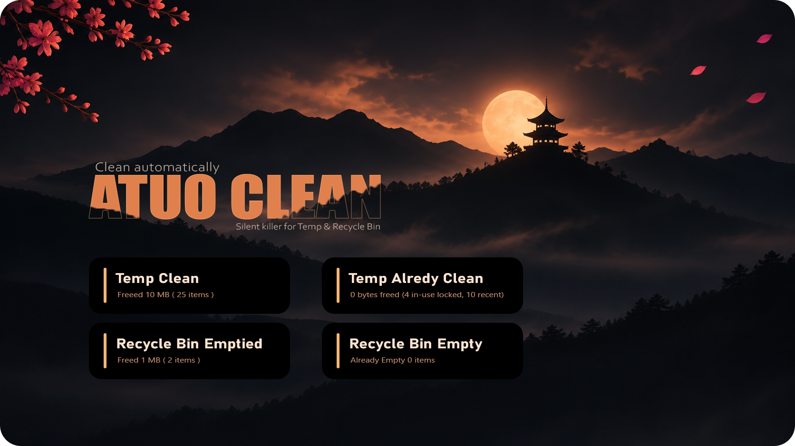

# AutoClean

### Event-driven background Temp folder and Recycle Bin cleaner with AI agent protection and toasts.

### **Install:** [AutoClean - Windhawk](https://windhawk.net/mods/autoclean)  · **Source:** [`AutoClean.wh.cpp`](https://github.com/k-ashix/ashix-windhawk-mods/blob/main/Auto_Clean/AutoClean.wh.cpp)

## How it Works
- **Event-Driven Watching:** Uses `ReadDirectoryChangesW` for `%TEMP%` and `SHChangeNotifyRegister` for the Recycle Bin so idle CPU and disk usage stay at zero.
- **Tool Mod Process:** Runs silently in a dedicated Windhawk Tool Mod process (`windhawk.exe`).

## Triggers
| Icon | Trigger | Action |
| :---: | :--- | :--- |
| 🖱️ | `3x Left-Click` *(Desktop / Taskbar empty space)* | Clean Temp folders immediately and show  corner toast |
| 🖱️ | `Middle-Click` (`1x`/`2x`/`3x`, *empty space*) | Empty Recycle Bin immediately and show  corner toast |
| 🚀 | `Windows Login / Startup` | Clean Temp folders (and optionally Recycle Bin) after login |
| 📦 | `Size Limit` (`KB`/`MB`/`GB`/`TB`) | Prune oldest items first or full sweep when limit is hit |
| 🔢 | `File Count Limit` (`X items`) | Prune oldest-deleted items or empty Recycle Bin at `X` items |
| ⏱️ | `Timer / Retention` | Clean Temp on a schedule and expire Recycle Bin items past retention |
| ⚠️ | `Low Disk Space` | Free Temp and oldest Recycle Bin items when free space drops below floor |

## Key Features
- **AI Agent `%TEMP%` Protection:** Preserves local scratchpads and worktrees from AI coding/desktop agents (Claude Code, Codex, Hermes, OpenClaw, Gemini CLI, OpenCode, Cursor, Windsurf, Goose, Aider, Copilot, MCP) by default.
- **Empty-Space Mouse Checks:** Uses UI Automation so taskbar buttons and desktop icons are never triggered.
- **Granular Controls:** Exact size caps, oldest-first pruning to a target percentage, wildcard exclusions, fullscreen/battery deferral, single-shot Dry-Run mode, and borderless OLED corner toasts.

## Safety Guards
- **Temp Path Validation:** Refuses to clean drive roots, `%windir%`, `%USERPROFILE%`, or known user folders if `%TEMP%` is misconfigured.
- **Age Grace Periods:** Default 24-hour (`1440 min`) grace period on Temp sweeps and Recycle Bin pruning protects active installers, builds, and recent deletions.
- **Reparse & Lock Safety:** Skips junctions/symlinks, respects Windows file locks, and restores Read-Only/Hidden/System attributes if a locked file cannot be deleted.
- **Conservative Defaults:** Automatic Recycle Bin size/count limits and startup cleaning are off by default; only 30-day age expiry is enabled out of the box.
