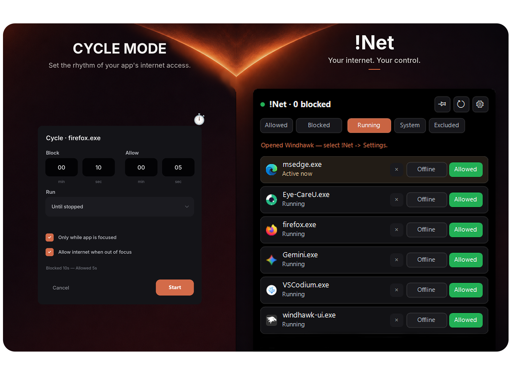

# !Net — Per-App Kill Switch

### A panel to manage per-app internet connections on Windows.  

### **Install:** [!Net - Windhawk](https://windhawk.net/mods/not-net) · **Source:** [`!NET.wh.cpp`](https://github.com/k-ashix/ashix-windhawk-mods/blob/main/Not_Net/!NET.wh.cpp)

## How it Works
- **Session-Only (default):** Blocks clear automatically on restart, shutdown, or exit. Uses (`FWPM_SESSION_DYNAMIC`). 

## Blocking Modes
- **Offline (default):** Blocks incoming and outgoing traffic.
- **Outbound:** Blocks outgoing connections only.
- **Inbound:** Blocks incoming connections only.

## Shortcuts
| Icon | Shortcut | Action |
| :---: | :--- | :--- |
| ⚡ | `Ctrl+Alt+Shift+1` | Toggle block/allow for foreground app (`!` key) |
| ◧ | `Ctrl+Alt+Shift+M` | Expand / collapse floating pill |
| ↺ | `Ctrl+Alt+Shift+R` | Restore all (clear session blocks) |

## Cycle Mode
- **Trigger:** Double-click an app row (or right-click → **Cycle...**).
- **Schedule:** Alternates **Blocked → Allowed** (`min | sec`, optional `ms`). Run **Until stopped**, **For N cycles**, or **For a set time** (with Windows clock sync in `12h`/`24h`).
- **Focus & Session:** Supports **Only while app is focused** and **Allow internet when out of focus**. Templates are saved in Windhawk storage; active cycles remain session-only.

## Chips
- **Allowed / Blocked:** Click **Blocked** again to switch between `!Net` blocks and **Blocked · FW** (Windows Defender Firewall rules).
- **Running / User:** Click **Running** again to toggle active apps vs. all running user apps.
- **System / Excluded:** View system processes or restore excluded apps.

## Permissions & Safety
- **Elevation:** Requires administrator rights for WFP filters (`windhawk-mod-elevated.exe` on Windhawk 2.0, or on-demand UAC on 1.7.3).
- **Protected Processes:** Core Windows OS, Windhawk hosts, Windows Defender/SmartScreen, and major AV/EDR processes are permanently locked.
- **Isolation & Guards:** Session 0 services and other user accounts are isolated by default. Warns before blocking active VPN or remote desktop clients.
