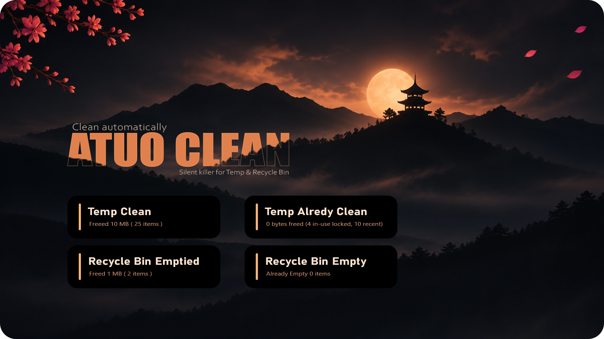
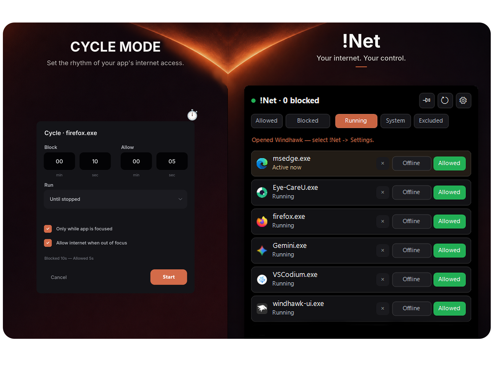
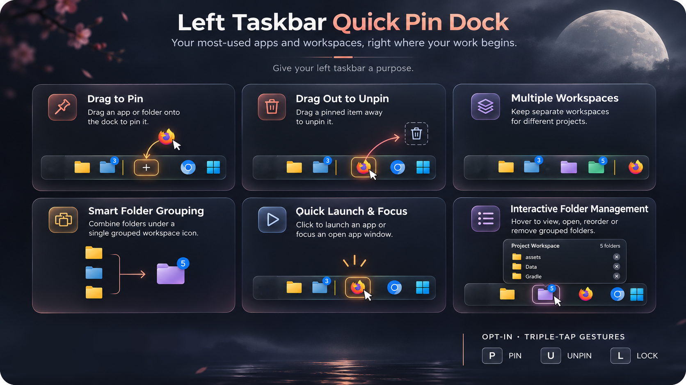
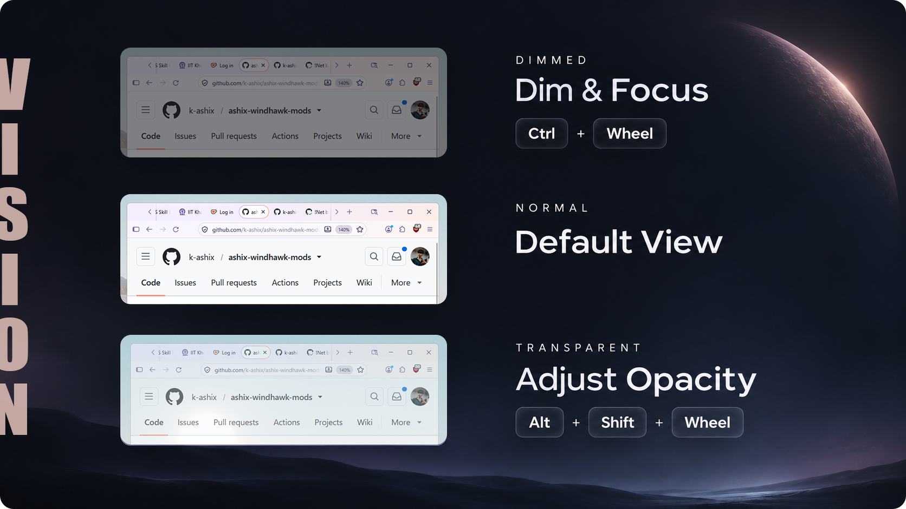

### A collection of custom [Windhawk](https://windhawk.net/) mods for Windows.
**Requirements:** [Windhawk Stable](https://windhawk.net) or [Windhawk Pre-release](https://github.com/ramensoftware/windhawk/releases).

## Mod Catalog

| Mod | Status / Registry | Overview |
| :--- | :--- | :--- |
| [**Not_Net**](./Not_Net/) | [Install on Windhawk](https://windhawk.net/mods/not-net) | Per-app internet access blocker with Cycle Mode scheduling |
| [**Taskbar_Quick_Pin**](./Taskbar_Quick_Pin/) | [Install on Windhawk](https://windhawk.net/mods/taskbar-quick-pin) | Edge Pill workspace dock and taskbar quick-pinning |
| [**Auto_Clean**](./Auto_Clean/) | Submitted (Awaiting Review) | Automated `%TEMP%` and Recycle Bin cleanup |
| [**Enhanced Alt+f4**](./Enhanced%20Alt+f4/) | Pre-Release | Hold or multi-tap `Alt+F4` to safely close all open user apps and open the native Shut Down dialog |
| [**Print Screen Quick-Actions**](./Print%20Screen%20Quick-Actions/) | Pre-Release | Single-tap, double-tap, or long-press `PrintScreen` to launch Snipping Tool Screenshot, Text Extractor, or Screen Recording |
| [**Vision**](./Vision/) | Polishing (Queued for Submission) | Window opacity and dim-and-focus control via scroll wheel |
| **Control Volume Knob** | In Development *(Coming soon)* | Turn any keyboard volume knob into a modifier-layered scroll wheel, cursor controller, and shortcut dial |

## Previews

<table>
  <tr>
    <td align="center" valign="middle" width="50%">
      
    </td>
    <td align="center" valign="middle" width="50%">
      
    </td>
  </tr>
  <tr>
    <td align="center"><a href="./Auto_Clean/"><strong>Auto_Clean</strong></a></td>
    <td align="center"><a href="./Not_Net/"><strong>Not_Net</strong></a></td>
  </tr>
  <tr>
    <td align="center" valign="middle" width="50%">
      
    </td>
    <td align="center" valign="middle" width="50%">
      
    </td>
  </tr>
  <tr>
    <td align="center"><a href="./Taskbar_Quick_Pin/"><strong>Taskbar_Quick_Pin</strong></a></td>
    <td align="center"><a href="./Taskbar_Quick_Pin/"><strong>Taskbar_Quick_Pin — Edge Pill</strong></a></td>
  </tr>
  <tr>
    <td align="center" valign="middle" colspan="2">
      
    </td>
  </tr>
  <tr>
    <td align="center" colspan="2"><a href="./Vision/"><strong>Vision</strong></a></td>
  </tr>
</table>

## Installation

1. **Install Windhawk:** Download the [stable release](https://windhawk.net) or the latest [pre-release build](https://github.com/ramensoftware/windhawk/releases).
2. **From Windhawk Registry (Recommended):** Click the **Install on Windhawk** link in the catalog above, or search the mod name inside the Windhawk app.
3. **Manual / Pre-Release Build:** Open Windhawk → **Create a new mod** → paste the contents of the mod's `.wh.cpp` file from its folder → click **Compile Mod**.
