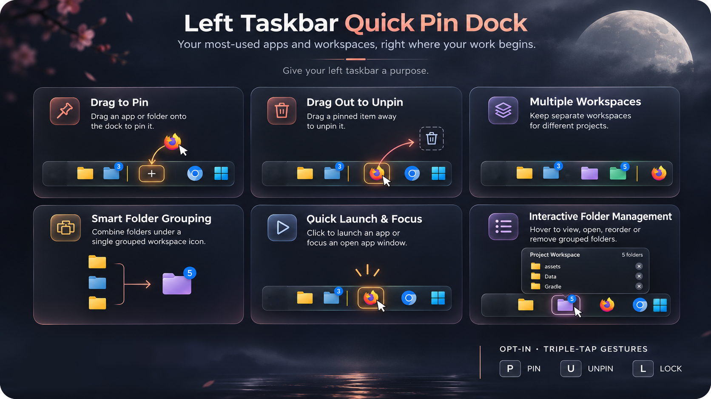
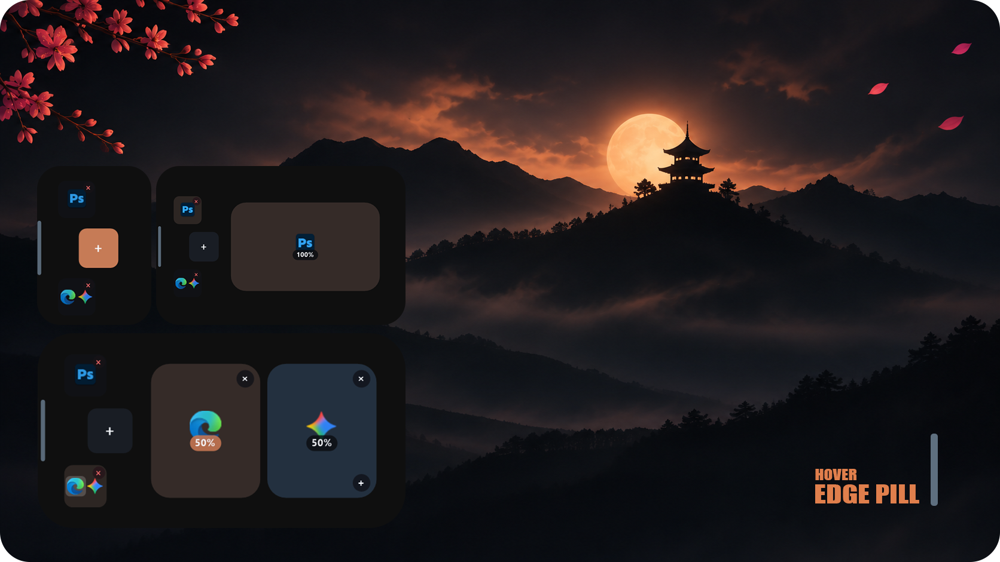

# Left Taskbar Quick Pin Dock

### A persistent icon dock anchored left of the Start button, plus a screen-edge workspace pill.

> **Windows 11 (centered taskbar) only.** On left-aligned or unsupported layouts, the dock stays hidden and idle.

### **Install:** [Taskbar Quick Pin - Windhawk](https://windhawk.net/mods/taskbar-quick-pin) · **Source:** [`Taskbar_Quick_Pin`](https://github.com/k-ashix/ashix-windhawk-mods/tree/main/Taskbar_Quick_Pin)

## Triggers
| Icon | Trigger | Action |
| :---: | :--- | :--- |
| 📌 | Drag app / Explorer window onto dock | Pin app, or pin **only the active tab** of that Explorer window |
| 🗂️ | `Ctrl` + Drag Explorer window onto dock | Group **all tabs inside that one Explorer window** |
| ➕ | Drag Explorer window onto workspace icon | Append active tab (or all tabs with `Ctrl`) |
| 🚀 | Left-click icon | Launch app/workspace, or focus its open window/tab |
| ↔️ | Drag icon left / right | Reorder icons within their section |
| 🗑️ | Double-click, right-click, or drag off dock | Unpin / delete item from the dock |
| 👁️ | Hover Edge Pill Arc Card | Show **Read-Only Thumbnail Preview** of captured apps & split ratios |
| 🛠️ | Right-click Arc Card | Open & lock **Customize Mode** to add (`+`/drag-drop) or delete (`×`/double-click) apps |
| ❌ | Click top-right `×` on Arc Card | Delete saved workspace state from the Edge Pill Arc |
| ⌨️ | `Ctrl + Alt + P` | Pin or unpin the focused app |
| 🔒 | Triple-tap `P` / `U` / `L` *(opt-in)* | Pin / Unpin / Lock dock |

## Explorer Grouping
- **Window Isolation:** Normal drag pins the active tab; `Ctrl` + Drag groups all tabs from that single Explorer window without merging separate windows.
- **Color Coding:** Single-folder workspaces stay native Windows yellow. Grouped (2+) workspaces get a distinct muted color from a 30-color palette.
- **Drop-Up Management:** Hover a grouped icon to view its frosted folder list, click inside to hold open, drag rows to reorder, or click `×` to remove.

## Edge Pill & Layouts
- **Screen-Edge Pill:** Anchored to the left edge by default; drag to any of the four edges or disable **Show Edge Pill** in settings.
- **Capture & Restore:** Click `+` on the Edge Pill arc to capture visible windows and their positions. Restoring launches closed apps and restores their layout.
- **Browser URL Capture (opt-in):** Off by default. When enabled, captures the active address bar URL of supported browsers to reopen on restore.
- **Hotkeys:** Edge Pill toggle and capture hotkeys are off (`none`) by default and configurable in settings.

## Key Settings
| Setting | Behavior | Default |
| :--- | :--- | :---: |
| **Limit visible pins before scrolling** | OFF = grow leftward up to safe edge; ON = cap slots and scroll | `OFF` |
| **Dock background style** | `Frosted glass pill` or `Transparent` | `Transparent` |
| **Max workspace pins** | Max workspace icons on the dock (`1 - 30`) | `10` |
| **Max visible paths in drop-up** | Visible rows before wheel scrolling (`3 - 20`) | `8` |
| **Grouped folder color mode** | `Random (unused colors first)` or `Fixed order` | `Random` |
| **Open grouped paths in separate windows** | OFF = tabs in one window; ON = separate windows | `OFF` |
| **Triple-tap `P` / `U` / `L` gestures** | Opt-in bare-key triple-tap to pin, unpin, or lock | `OFF` |
