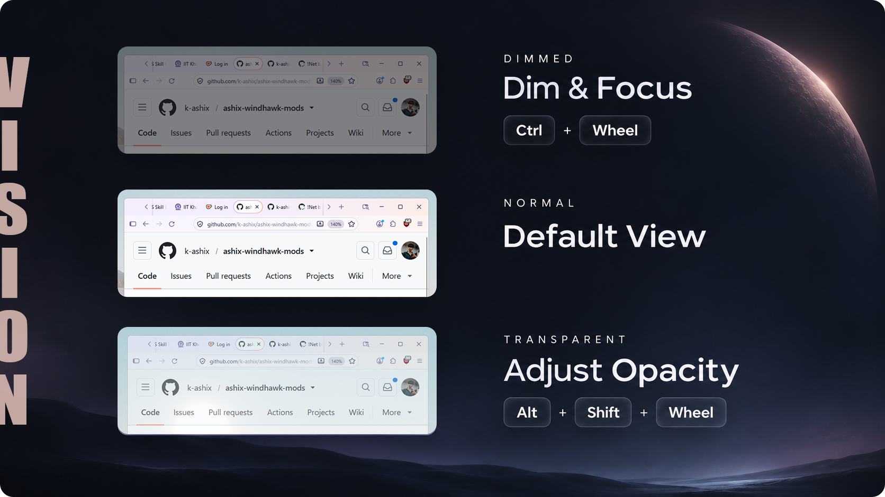

# Vision

### Per-window opacity, always-on-top pinning, and brightness-aware dimming via title-bar mouse gestures.

### **Status:** Polishing *(Queued for Submission)* · **Source:** [`Vision`](https://github.com/k-ashix/ashix-windhawk-mods/tree/main/Vision)

## Triggers
| Icon | Trigger | Action |
| :---: | :--- | :--- |
| 🌗 | `Alt + Shift + Wheel` *(over title bar)* | Adjust window opacity (`25%–100%`, `5%` step) |
| 📌 | `Alt + Shift + Middle-Click` *(over title bar)* | Toggle always-on-top (`TOPMOST`) |
| 🌙 | `Ctrl + Wheel` *(over title bar)* | Adjust dim overlay *(soft filter, never 100% pitch black)* |
| 🔁 | `Ctrl + Double-Click` *(over title bar)* | Toggle saved per-app dim preset ON/OFF without erasing it |
| 🎛️ | Header `%` Button & Slider *(opt-in)* | Borderless circle `%` button; hover reveals slider |

## Key Features
- **Flicker-Free Capture Guard:** Detects Snipping Tool (`ScreenClippingHost.exe`, `SnippingTool.exe`), Screen Sketch, Xbox Game Bar, ShareX, and Lightshot; holds dim and opacity states cleanly during capture and auto-restores afterward.
- **Screenshot & Opacity Exclusion:** Supports `exclude_all`, `show_dim`, `show_controls`, and `show_all`, with automatic opacity restoration during excluded captures so background windows never bleed through.
- **Zero-Strip Atomic Resize:** Uses `CS_HREDRAW | CS_VREDRAW` brush-backed overlays without `SWP_NOCOPYBITS` so resizing dimmed windows never flashes black or white strips.
- **Text Clarity & Crispness:** Optional `Text-Clarity` controls keep text readable via hover/focus clarity boost, contrast-preserving dark backing, and smart alpha floor clamping.
- **Hardware Brightness SSOT:** Never polls or touches DDC/CI, WMI, or gamma ramps. Your monitor's hardware/OSD brightness (e.g., BenQ Eye-CareU) remains the 100% baseline.
- **Dual Compatible:** Runs as a dedicated Windhawk Tool Mod (`windhawk-mod.exe` & `windhawk.exe`) on both Windhawk 1.7.3 and 2.0.
